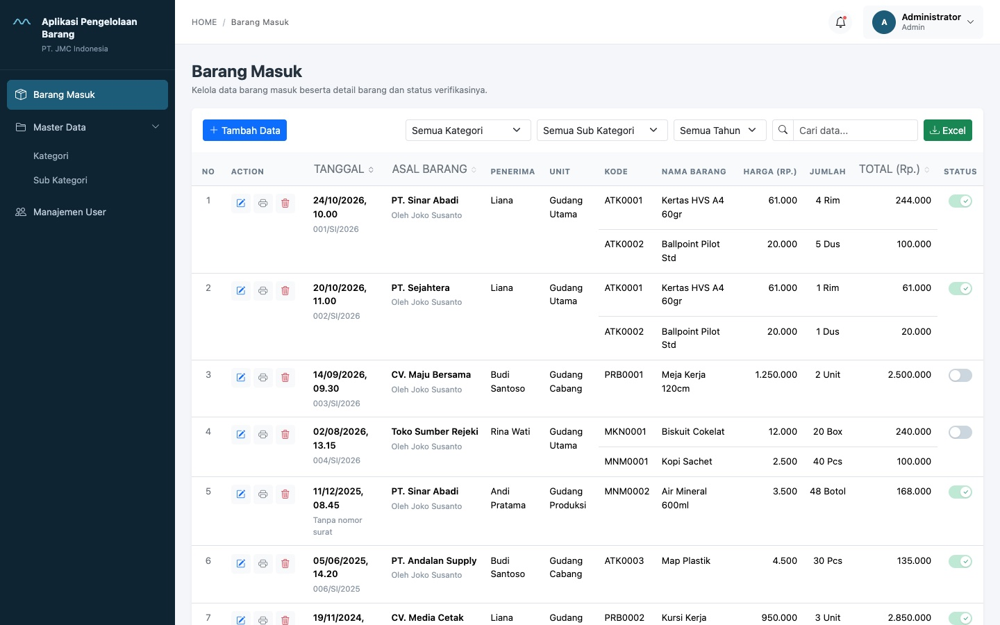

# Aplikasi Pengelolaan Barang

Aplikasi pencatatan barang masuk dengan modul Master Data (Kategori & Sub Kategori) dan Manajemen User. Ada dua role: Admin dan Operator.

## Link

| Keterangan | URL |
| --- | --- |
| Live Demo | `https://GANTI-DENGAN-URL-VERCEL.vercel.app` |
| Video Demo | `https://GANTI-DENGAN-URL-VIDEO` |
| Repository | `https://github.com/GANTI-USERNAME/aplikasi-pengelolaan-barang` |

> Ganti ketiga URL di atas sebelum dikumpulkan.



## Tech Stack

| Layer | Teknologi |
| --- | --- |
| Frontend | React 18 + Vite + React Router 6 + Bootstrap 5 |
| Backend | Node.js 20 + Express 4 (REST API) |
| Database | PostgreSQL 16 (Supabase) |
| Auth | JWT + bcrypt |
| Upload | Supabase Storage (lokal: folder `uploads/`) |
| Export | ExcelJS |
| Deployment | Vercel + Supabase |

## Akun Pengujian

| Role | Username | Password |
| --- | --- | --- |
| Admin | `administrator` | `Admin12345` |
| Operator | `operator1` | `Operator12345` |
| Operator | `operator2` | `Operator12345` |
| Operator | `operator3` | `Operator12345` |

## Jalankan Lokal

Butuh Node.js 20+ dan PostgreSQL 14+.

```bash
git clone https://github.com/GANTI-USERNAME/aplikasi-pengelolaan-barang.git
cd aplikasi-pengelolaan-barang
npm install

cp .env.example .env
# sesuaikan DATABASE_URL di .env, contoh:
# DATABASE_URL=postgresql://localhost:5432/jmc_barang
# PGSSLMODE=disable

createdb jmc_barang
npm run db:setup   # buat tabel + data awal (aman dijalankan ulang)
npm run dev        # API :3001 + frontend :5173
```

Buka http://localhost:5173.

Perintah lain:

```bash
npm run build     # build frontend ke dist/
npm run start     # jalankan API mode produksi
npm run db:setup  # schema + seed
```

## Deploy (Vercel + Supabase)

1. Buat project Supabase, lalu salin connection string **pooling** (port 6543).
2. Buat bucket Storage bernama `lampiran` dan set **public**.
3. Jalankan `npm run db:setup` dengan `DATABASE_URL` diarahkan ke Supabase (atau jalankan `db/schema.sql` lewat SQL Editor).
4. Import repo ke Vercel, tambahkan environment variables:

   | Key | Value |
   | --- | --- |
   | `DATABASE_URL` | connection string pooler Supabase |
   | `PGSSLMODE` | `require` |
   | `JWT_SECRET` | string acak panjang |
   | `JWT_EXPIRES_IN` | `12h` |
   | `SUPABASE_URL` | `https://xxxx.supabase.co` |
   | `SUPABASE_SERVICE_ROLE_KEY` | service role key |
   | `SUPABASE_BUCKET` | `lampiran` |

5. Deploy, lalu isi URL hasil deploy ke bagian Link di atas.

Lampiran disimpan di Supabase Storage karena filesystem Vercel read-only.

## Catatan

- Password di-hash dengan bcrypt, sesi memakai JWT Bearer token.
- Batas harga sub kategori divalidasi di client dan diulang di server.
- Semua query pakai parameterized query (`pg`).
- Kolom uang memakai `NUMERIC(16,2)`, ditampilkan dalam format rupiah.
- User yang di-lock tidak bisa login; pengecekan dilakukan di setiap request, bukan hanya saat login.
